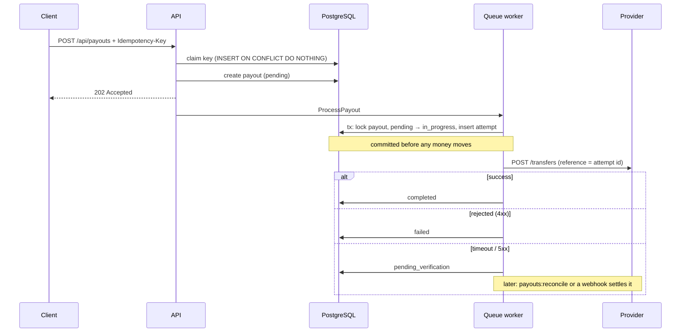
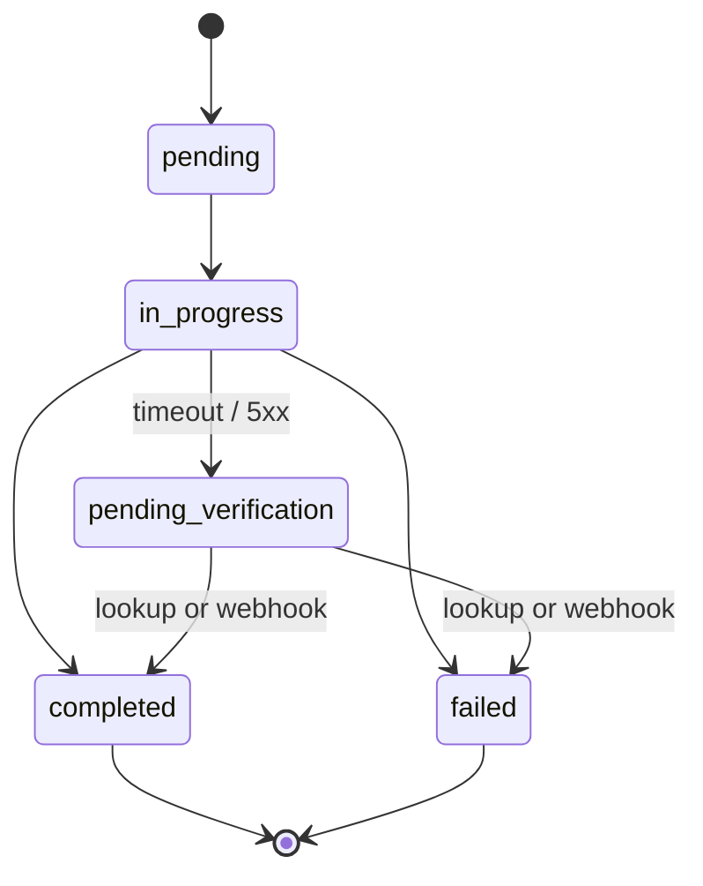

# Idempotent Payments

[](https://github.com/Frankva12/idempotent-payments/actions/workflows/ci.yml)

**A payout API that never pays twice, even when clients retry, workers crash, and the provider times out.**

Moving money looks simple: receive a request, call the payment provider, save the result. In production every step of that can repeat or vanish. A client retries after a network blip, a queue redelivers a job, the provider answers with a timeout after the money already moved, and webhooks arrive twice or out of order. Each of those is a chance to pay someone twice.

This project is a small, self-contained version of patterns I apply on a fintech lending platform. It contains no proprietary code. The domain is generic: a platform that sends payouts to customer wallets through an external provider.

## What can go wrong, and what stops it

| Failure | What protects against it | Where |
|---|---|---|
| The client sends the same request twice | `Idempotency-Key` header; the stored response is replayed | `EnsureIdempotency` middleware |
| Two identical requests arrive at the same time | The key is claimed with one atomic `INSERT … ON CONFLICT DO NOTHING`; the loser gets `409` | `EnsureIdempotency` |
| The provider times out or returns 5xx | Treated as **unknown**, not failed: the payout is parked in `pending_verification` and never re-sent | `PayoutProcessor` |
| The job runs twice or the worker dies mid-call | An attempt is recorded **before** the provider call; only a `pending` payout can be sent | `PayoutProcessor`, `payouts:reconcile` |
| The provider redelivers a webhook | Unique `provider_event_id`; a repeat is a no-op | `ProviderWebhookController` |

## How a payout flows



## State machine



Any other transition throws `InvalidPayoutTransition`. A verdict that repeats the current status is a no-op. A verdict that contradicts a final status, such as a late "failed" webhook for a completed payout, is logged for a human and never overwrites it.

## Design decisions and trade-offs

**A timeout is not a failure.** If the provider does not answer, the money may or may not have moved. Marking the payout as failed invites a retry, and a retry can pay twice. The payout waits in `pending_verification` until the provider confirms one way or the other.

**Never call the provider inside a database transaction.** A rollback cannot un-send money, and the row locks would be held for the whole network round trip. Processing uses two short transactions around the call: one records the intent, the other records the verdict.

**Record the intent first.** The attempt row is committed before the HTTP call. If the worker crashes, the attempt is still there, and reconciliation can ask the provider about it by its reference.

**One fresh reference per attempt.** The provider reference is the attempt's UUID. It is never derived from counters or business identifiers, which can be reused after a rollback.

**Do not rely on the provider to deduplicate.** Even with unique references, idempotency is enforced on our side through the state machine, because many providers do not guarantee it.

**Let the database decide races.** Unique indexes on the idempotency key, the provider event id and the transfer reference are the last line of defense: application code can have bugs, and the index will still reject the duplicate.

**Fail safe, not open.** A request that crashes mid-flight keeps its idempotency key locked until the key expires (24 hours). A stuck retry is better than a double payment. The webhook endpoint rejects everything if no secret is configured.

**Money is an integer.** Amounts are stored in cents (`1050` = 10.50 USD). Floats cannot represent most decimal amounts exactly.

### What I would add for production
- Scope idempotency keys per API client (here they are global because there is no auth).
- Alerting on payouts that stay in `pending_verification` for too long, and on conflicting verdicts.
- A transactional outbox to publish payout events to other services.
- Rate limiting and authentication on the public endpoints.

## API

| Method | Path | Notes |
|---|---|---|
| `POST` | `/api/payouts` | Requires `Idempotency-Key`. Returns `202` with the pending payout. |
| `GET` | `/api/payouts/{id}` | Current status. |
| `POST` | `/api/webhooks/payout-provider` | HMAC-SHA256 over `timestamp.body` in `X-Provider-Signature`; `X-Provider-Timestamp` must be within 5 minutes. |

OpenAPI docs are generated by [Scramble](https://scramble.dedoc.co) at `/docs/api` when running locally.

### Responses to the idempotency key

| Situation | Response |
|---|---|
| New key | The request runs normally |
| Same key, same payload, finished | The original response, with `Idempotent-Replayed: true` |
| Same key, still running | `409 Conflict` |
| Same key, different payload | `422` |
| Missing key | `400` |

## Run it

Requires Docker.

```bash
git clone https://github.com/Frankva12/idempotent-payments.git
cd idempotent-payments
cp .env.example .env
docker run --rm -v "$PWD":/app -w /app laravelsail/php84-composer:latest composer install
./vendor/bin/sail up -d
./vendor/bin/sail artisan key:generate
./vendor/bin/sail artisan migrate
```

### Try the dangerous case: a timeout after the money moved

The local provider is simulated, and the cents of the amount pick the scenario, like a payment sandbox: `…13` times out after the money moved, `…99` is rejected, and anything else succeeds.

```bash
# 1. Create a payout that will time out
curl -s -X POST localhost/api/payouts \
  -H 'Content-Type: application/json' -H 'Accept: application/json' \
  -H 'Idempotency-Key: demo-1' \
  -d '{"wallet_id":"wal_42","amount":1013,"currency":"USD"}'

# 2. Send it again: same response, header Idempotent-Replayed: true, no second payout

# 3. Process the queue: the payout ends in pending_verification, not failed
./vendor/bin/sail artisan queue:work --stop-when-empty

# 4. Reconcile: the provider confirms the money arrived, so the payout is completed
./vendor/bin/sail artisan payouts:reconcile --stale-after=0
```

## Quality

```bash
./vendor/bin/sail artisan test               # Pest: 72 tests
./vendor/bin/sail bin phpstan analyse        # PHPStan level 8 (Larastan)
./vendor/bin/sail bin pint --test            # Code style
```

The tests cover each guarantee directly. Examples:
- The same request twice creates one payout.
- A timeout leaves the payout in `pending_verification`, and running it again does not call the provider.
- The attempt is on record before the provider is called.
- A redelivered webhook changes nothing.
- A contradicting webhook is logged and ignored.

CI runs all three checks against PostgreSQL on every push.

## Stack

PHP 8.4+ · Laravel 13 · PostgreSQL 18 · Redis · Pest · PHPStan (Larastan) · Scramble · Docker (Sail) · GitHub Actions
